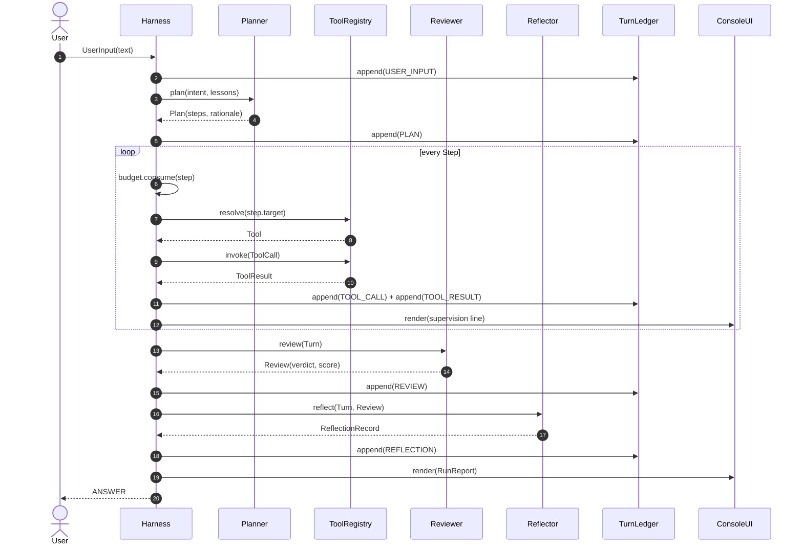

# Pre-Architecture — Gemma 4 12B Agentic Harness

> 状态：v2.5 / TB-0～TB-7 + delegate + TUI + Web（多会话/token/TLS/Markdown/多模态附件）+ 取消/滚动 + bwrap + 命令 profile + Q4 主脑/ngl 降档 + token 预算 8192 + 评审门禁/证据校验/动态步数/双语 RAG + 父块扩展 + FTS5 hybrid + 演进 Phase 0/1 提案协议 + Agents_opinion 归档 + 可选模型启动 + 双击启动器已落地（2026-10-31）
> 方法：tracer bullet（先打通一条端到端最薄切片，再逐片加厚）
> 语言约定：文档中文；代码标识符、日志、UI 文案英文（运行环境无需中文）

---

## 0. 现状核对（2026-10-29 实测）

| 项 | 事实 | 影响 |
| --- | --- | --- |
| 工作区 | `/home/cielo_1/projects/my_agent` 为空，无 git | 从零开始，进度为 0 |
| GPU | RTX 4080 Laptop, 12282 MiB | 只能常驻 1 个模型 |
| llama.cpp | 0.6.0-dev build 11574，含 `llama-server`、`llama-mtmd-cli` | 统一走 OpenAI 兼容 HTTP |
| Python | 3.14.4，**无 numpy / httpx / pydantic / rich** | 坚持 stdlib-only，不引入运行时依赖 |
| 模型文件 | `gemma4-v2-Q4_K_M.gguf` 6.9G、`LFM2.5-8B-A1B-Q6_K.gguf` 6.5G、`Qwen3-ASR-1.7B-Q4_K_M.gguf` + 其 `mmproj`、`Qwen3-VL-8B-Instruct-q6_k.gguf` | 主/次/ASR 可用；Q6_K 主脑因 KV cache OOM 已由 Q4_K_M 取代（ADR-033） |
| 已补 | `mmproj-Qwen3VL-8B-Instruct-Q8_0.gguf`（752 MB，R1） | 图片输入可用 |
| 已补 | `Qwen3-Embedding-0.6B-Q8_0.gguf`（639 MB，R2） | RAG 可用 |

---

## 1. Ubiquitous Language（统一语言）

| 术语 | 含义 | 不叫 |
| --- | --- | --- |
| **Turn** | 一次用户输入到一次交付的完整生命周期 | session、request |
| **Envelope** | 组件间唯一通信信封（JSON） | message、event |
| **Ledger** | 一个 Turn 内全部 Envelope 的追加式流水 | history、log |
| **Intent** | 主 agent 对用户输入的结构化理解 | query、ask |
| **Plan** | 有序 Step 列表 + 决策理由 | task list、todo |
| **Step** | 计划中最小执行单元（调工具 / 委派 / 作答） | action、node |
| **ToolCall / ToolResult** | 工具调用的请求与回执 | function call |
| **Supervision** | Harness 对节点决策与调用的实时监督上报 | monitor、trace |
| **Review** | 次 agent 对结果的评审意见 | critique、eval |
| **RunReport** | Harness 生成的一轮运行监督报告 | summary、metrics |
| **Reflection** | 主 agent 的学习与反思记录 | learn、feedback |
| **Escalation** | 经用户同意后调用场外 SOTA 模型 | fallback、handoff |
| **Role** | 模型当前扮演的身份（planner / executor / reviewer） | persona |
| **Guardrail** | 与 CrewAI 对齐的输入/输出/工具校验 | filter、policy |

---

## 2. 决策记录（ADR）

| # | 决策 | 理由 |
| --- | --- | --- |
| ADR-1 | **单常驻模型 + 热切换**：`ServerSupervisor` 保证同一时刻只有一个 `llama-server` 进程占卡，按 Role 换模型 | 12 GB VRAM 装不下 Gemma 12B(Q6) + LFM 8B；且需求要求"一次只 call 一个模型" |
| ADR-2 | **唯一协议 Envelope**：跨组件/跨进程边界（UI、工具、模型、记忆文件、上报）一律 JSON Envelope；工具统一 `invoke(ToolCall) -> ToolResult`。`core` 内部值对象用 frozen dataclass，一进边界即序列化 | 需求"通信格式统一 JSON、接口统一"；同时避免领域层被 JSON 污染 |
| ADR-3 | **stdlib-only**：HTTP 用 `urllib.request`，存储用 `sqlite3`，配置用 `tomllib`，TUI 用 `curses`/ANSI | 环境无第三方包；"优先使用标准库已有能力、非必要不集成" |
| ADR-4 | **RAG 嵌入模型 = Qwen3-Embedding-0.6B（GGUF, Q8_0, 1024 维）** | 与主模型同源工具链，llama.cpp 直接 `--embeddings`；32k 上下文适合整篇 .md；中文/英文/代码混合检索强；0.6B 换卡开销小。备选 bge-m3（更重、需另装） |
| ADR-5 | **Guardrail 对齐 CrewAI**：`GuardrailOutcome(success, value, error, retries)`，`max_retries=3`，分 input / output / tool 三个检查点 | 需求"guardrail 直接跟 crew AI 保持一致" |
| ADR-6 | **分层但只做必要分离**：`core`（纯领域，无 IO）/ `ports` / `adapters` / `tools` / `knowledge` / `ui` / `config`；UI 只消费 Envelope | 外观/配置/主题与核心逻辑分离 |
| ADR-7 | **FP64 统一**：向量用 `array("d")`，相似度/评分/计时一律 `float`（双精度），禁止 `float32` / `struct "f"` | 需求"使用浮点数时统一使用 FP64" |
| ADR-8 | **计划与评审走 schema 约束解码**（`response_format.json_schema` → llama.cpp GBNF） | 保证 Plan/Review 一定是合法 JSON，减少解析失败 |

**我替你补决的两项**（可推翻）：ADR-3 的零依赖、ADR-4 的 Qwen3-Embedding-0.6B。

---

## 3. Trace Bullet：端到端最薄切片

原则：每一片都是"从输入到输出可跑通"的竖直切面，不是横向铺模块。
切片顺序即实现顺序；每片有可执行验收标准，未通过不进下一片。

| 切片 | 内容（新增） | 验收标准（检查无误的判据） |
| --- | --- | --- |
| **TB-0 骨架** ✅ 2026-10-29 | Envelope + TurnLedger + Harness 主循环 + `LlamaCppBrain` + `ServerSupervisor` + 1 个 `echo` 工具 + `ConsoleUI` 单轮模式 | 已达成：`--once "ping" --json` 返回 `kind=ANSWER`；ledger 5 事件（USER_INPUT→PLAN→TOOL_CALL→TOOL_RESULT→ANSWER）且 call_id 成对；零第三方 import；主脑为校验通过的 gemma4-v2（文件损坏 → 重下 → sha256 通过，见 ADR-008） |
| **TB-1 计划与工具** ✅ 2026-10-30 | Planner（json_schema 出 Plan）+ ToolRegistry + `workspace.list_dir` / `workspace.read_file` + Guardrail 路径沙箱 + 1 次计划修复重试 | 已达成：`list_dir` + `read_file` 实跑成功并基于结果作答（38.6 s）；`/etc/passwd` 被 `DENIED_BY_GUARDRAIL` 拒绝且答案如实说明（33.3 s）；坏计划 1 次重试（ADR-010）、越界拒绝不执行工具（ADR-009） |
| **TB-2 评审与报告** ✅ 2026-10-30 | Reviewer（LFM2.5，role=review）+ Reporter + RunReport（json + md）+ 路由换模型 | 已达成：评审 `PASS 1.00` 连续 3 次稳定；报告含 plan/review/answer 分段耗时、失败码、重试数（29–36 s/轮）；评审失败降级为 `ERROR(UPSTREAM_ERROR)` 且答案照常交付 |
| **TB-3 RAG** ✅ 2026-10-30 | MarkdownLoader + Chunker + `LlamaCppEmbedder`（role=embed）+ `SqliteVectorStore`（FP64 BLOB）+ `knowledge.index/search/read_section/list_documents` | 已达成：`docs/` 索引 18 文档 / 160 chunk / dim=1024；查询 top-3 全为相关 ADR（0.689/0.663/0.584）；12 项断言含 FP64 往返逐位相等、余弦边界、空索引报错 |
| **TB-4 记忆与反思** ✅ 2026-10-30 | Reflector（role=review）+ `JsonlMemoryStore` + `memory.recall/record/request_tool_change` + 计划提示注入 lessons | 已达成：第 2 轮 `PLAN.meta.lessons=1`；`memory.jsonl` 两轮 2 行只追加；请愿只写 `tool_requests.jsonl`；反思失败不产生 ERROR 且不阻断交付 |
| **TB-5 媒体输入** ✅ 2026-10-30 | `MediaPort` + `LlamaCppMedia`（asr/vl 同一实现）+ `perception.transcribe` / `perception.describe_image` + mmproj 门禁 | 已达成：`docs/probe.png` → `perception.describe_image` → 答案"deep blue"（88.0 s，含两次换模型）；缺 mmproj 时配置层与适配器层各挡一次（`MISSING_MMPROJ`），7 项断言覆盖 |
| **TB-6 预算与升级** ✅ 2026-10-30 | TurnBudget(3) + ProgressWatch + Escalator + Redactor + CONSENT_REQUEST 交互 | 已达成：可重试错误恰好尝试 3 次（2 次 RETRY）；预算耗尽发 `CONSENT_REQUEST`；拒绝 → `ERROR(ABORTED)` 且无 ANSWER；同意 → 脱敏 payload 外发，结果作为 `TOOL_RESULT` 证据进入答案；未配置 master → `ERROR(UPSTREAM_ERROR)` 仍交付答案；不可重试错误不重试、不询问 |
| **TB-7 角色切换** ✅ 2026-10-30 | RoleRegistry + `delegate.switch_role` | 已达成：同一 Turn 内 `TOOL_CALL → TOOL_RESULT → ROLE_SWITCH`，`main -> review alias=sub`；切换后答案由 sub 生成；未知角色 `BAD_ARGS` 且不回落；ledger 只有一个 turn_id、上下文不重置 |

**TB-0 的"检查无误"定义**：能画出下面的时序图并且在代码里逐跳对上（ledger 事件序列 = 图上顺序）。

---

## 4. 一轮 Turn 的状态机

```
INGEST ──► PLANNING ──► ACTING ──► SUPERVISING ──► REVIEWING ──► REPORTING ──► REFLECTING ──► DELIVERED
              ▲             │            │
              │             └─ step 失败 ─┴─► (attempts < 3) 回到 ACTING
              │                                  (attempts = 3) ──► AWAITING_CONSENT
              │                                                       ├─ 同意 ──► ESCALATING ──► DELIVERED
              └──────────────── 用户补充/修正 ◄── 拒绝 ───────────────┴─ 拒绝 ──► ABORTED
```

- 同一 Turn 内**共享同一上下文**（`TurnLedger` 即唯一事实来源），不 fork、不并行。
- 升级检查点：`ProgressWatch.fingerprint = sha1(intent + plan.tool_sequence)`；同一指纹出现 ≥ `escalation_rounds`(3) 轮 → `ESCALATION_SUGGESTED`。
- `REFLECTING` 在交付前执行，但反思失败不阻塞交付（只记 warning）。

---

## 5. 统一通信协议

### 5.1 Envelope（唯一信封）

```json
{
  "kind": "TOOL_CALL",
  "message_id": "m-0007",
  "turn_id": "t-20261029-0003",
  "sender": "harness",
  "payload": {},
  "meta": { "ts": 1793, "seq": 7, "role": "executor", "step_id": "s-2" }
}
```

- `kind` ∈ `USER_INPUT | INTENT | PLAN | STEP | TOOL_CALL | TOOL_RESULT | REVIEW | RUN_REPORT | REFLECTION | CONSENT_REQUEST | ROLE_SWITCH | ANSWER`
- `payload` 按 `kind` 定 schema；`meta` 只放不参与语义的旁路信息（时间、序号、角色）。
- 编解码：`protocol.Envelope.to_json()` / `from_json()`；非法 payload 一律拒绝并产生 `ToolResult(ok=false)` 或 `GuardrailOutcome`。

### 5.2 工具三元组

```json
{ "call_id": "c-0007", "tool": "knowledge.search", "args": { "query": "release checklist", "k": 5 } }
{ "call_id": "c-0007", "ok": true, "data": { "hits": [] }, "error": null, "elapsed_s": 0.0421 }
{ "call_id": "c-0007", "ok": false, "data": {},
  "error": { "code": "TIMEOUT", "message": "...", "retryable": true, "hint": "reduce k" } }
```

错误码（固定枚举）：`BAD_ARGS | NOT_FOUND | TIMEOUT | DENIED_BY_GUARDRAIL | UPSTREAM_ERROR | MISSING_MMPROJ | INTERNAL`。
**retryable 由错误码决定，不由 LLM 决定**——避免模型自我宽容。

### 5.3 模型侧 JSON 契约

| 产物 | 关键字段 |
| --- | --- |
| `Plan` | `intent{goal, task_class, constraints}`, `steps[{kind, target, args, why}]`, `rationale`, `order_reason` |
| `Review` | `verdict(PASS/REVISE/FAIL)`, `score(0..1)`, `issues[]`, `suggestions[]` |
| `Reflection` | `lessons[]`, `plan_hint`, `tool_notes[]`, `change_request` |

---

## 6. 函数计划（只列函数与职责，不写实现）

### 6.1 主 agent 可见的工具目录（7 大类）

主 agent 在选择工具时只看到这张表的"大类 + 一句话 + args schema"，不看到实现。

| 大类 | 前缀 | 工具（计划） | 何时选 |
| --- | --- | --- | --- |
| **感知 Perception** | `perception.` | `transcribe_audio` `describe_image` `attach_file` | 输入含语音/图片/附件 |
| **知识 Knowledge** | `knowledge.` | `search` `read_section` `list_documents` `reindex` | 需要 .md 流程/SOP 作为计划参考 |
| **工作区 Workspace** | `workspace.` | `read_file` `list_dir` `write_file` `run_command` | 读写产物、跑校验（写/执行受 guardrail） |
| **委派 Delegate** | `delegate.` | `review` `draft` `switch_role` | 要第二意见、要先出草稿、要换身份 |
| **场外 Escalate** | `escalate.` | `handle_to_master`（仅 Harness 可触发，需用户同意） | 同一输入多轮无进展且用户同意 |
| **记忆 Memory** | `memory.` | `recall` `record` `request_tool_change` | 计划前召回经验、事后沉淀、申请改工具 |
| **交付 Deliver** | —（Step.kind=ANSWER） | 非工具：由 `AnswerComposer` 产出 | 收尾 |

命名规范：`category.verb_object`，全小写蛇形；新增工具必须先在 `ToolSpec.category` 登记大类。

> 已落地：Perception 的 `attach_file`/`transcribe_audio`/`describe_image`；Knowledge 的 `index`/`reindex`/
> `search`/`read_section`/`list_documents`；Workspace 的 `echo`/`list_dir`/`read_file`/`write_file`/`run_command`；
> Delegate 的 `switch_role`/`draft`/`review`；Memory 的 `recall`/`record`/`request_tool_change`。
> 仍属计划：`escalate.handle_to_master`（仅 Harness 触发，接口已留）。

### 6.2 非工具函数（按模块）

**Harness 编排（core/harness）**
`run_turn` `ingest` `plan_turn` `act` `execute_step` `supervise` `review` `build_report` `reflect` `deliver` `ask_consent` `abort`

**预算与推进（core/policy）**
`TurnBudget.consume` `TurnBudget.exhausted` `ProgressWatch.note` `ProgressWatch.rounds_for` `ProgressWatch.stalled` `ProgressWatch.fingerprint`

**护栏（core/policy）**
`Guardrail.check_input` `check_output` `check_tool`；结果恒为 `GuardrailOutcome{success, value, error, retries}`

**升级（core/policy）**
`Escalator.needs_consent` `Escalator.escalate` `Redactor.redact` `Redactor.classify`

**模型接入（adapters）**
`LlamaCppBrain.complete` `LlamaCppBrain.health` `ServerSupervisor.ensure` `ServerSupervisor.resident` `ServerSupervisor.stop` `HandleToMaster.complete` `RoleRegistry.resolve` `RoleRegistry.switch_role`

**知识（knowledge）**
`MarkdownLoader.load` `Chunker.split` `KnowledgeBase.index_documents` `KnowledgeBase.search` `KnowledgeBase.read_section` `LlamaCppEmbedder.embed` `SqliteVectorStore.upsert` `SqliteVectorStore.top_k` `cosine_fp64`

**学习（core/learning）**
`Reviewer.review` `Reflector.reflect` `MemoryPort.append` `MemoryPort.recall` `MemoryPort.pending_changes` `ReflectionRecord.merge`

**媒体（adapters/media）**
`AsrAdapter.transcribe` `VlAdapter.describe`

**报告与交付（core/report）**
`Reporter.build` `RunReport.to_markdown` `AnswerComposer.compose`

**UI（ui）**
`ConsoleUI.render` `ConsoleUI.ask_consent` `Presenter.project` `Theme.palette`

---

## 7. 类图（mermaid）

```mermaid
classDiagram
    direction LR

    namespace protocol {
        class Envelope {
            +str message_id
            +str turn_id
            +MessageKind kind
            +str sender
            +dict payload
            +dict meta
        }
        class MessageKind {
            <<enumeration>>
            USER_INPUT
            INTENT
            PLAN
            STEP
            TOOL_CALL
            TOOL_RESULT
            REVIEW
            RUN_REPORT
            REFLECTION
            CONSENT_REQUEST
            ROLE_SWITCH
            ANSWER
        }
        class TurnState {
            <<enumeration>>
            INGEST
            PLANNING
            ACTING
            SUPERVISING
            REVIEWING
            REPORTING
            REFLECTING
            AWAITING_CONSENT
            DELIVERED
            ABORTED
        }
        class UserInput {
            +str text
            +List~Attachment~ attachments
        }
        class Attachment {
            +str modality
            +str path
        }
        class Turn {
            +str turn_id
            +TurnState state
            +UserInput input
        }
        class TurnLedger {
            +append(Envelope envelope) None
            +events() List~Envelope~
            +to_transcript() List~dict~
        }
    }

    namespace planning {
        class Planner {
            +plan(dict intent, List~dict~ lessons) Plan
        }
        class Plan {
            +List~Step~ steps
            +str rationale
            +str fingerprint
        }
        class Step {
            +str step_id
            +StepKind kind
            +str target
            +dict args
            +StepStatus status
            +int attempts
        }
        class StepKind {
            <<enumeration>>
            TOOL
            DELEGATE
            ANSWER
        }
        class StepStatus {
            <<enumeration>>
            PENDING
            RUNNING
            OK
            FAILED
            SKIPPED
        }
    }

    namespace brains {
        class BrainPort {
            <<interface>>
            +complete(BrainRequest request) BrainReply
            +health() bool
        }
        class BrainRequest {
            +List~dict~ messages
            +dict json_schema
            +float64 temperature
        }
        class BrainReply {
            +dict content
            +str raw
            +int tokens
        }
        class LlamaCppBrain {
            +str model_alias
            +complete(BrainRequest request) BrainReply
            +health() bool
        }
        class HandleToMaster {
            +str base_url_env
            +str api_key_env
            +complete(BrainRequest request) BrainReply
        }
        class ServerSupervisor {
            +ensure(str alias) str
            +resident() str
            +stop() None
        }
        class ModelProfile {
            +str alias
            +str gguf_path
            +str mmproj_path
            +int n_ctx
            +int port
        }
        class RoleRegistry {
            +str current
            +resolve(str role) str
            +switch_role(str role) str
        }
    }

    namespace harness {
        class Harness {
            +run_turn(UserInput input) Envelope
            +plan_turn(Turn turn) Plan
            +act(Turn turn, Plan plan) None
            +review(Turn turn) Review
            +reflect(Turn turn) ReflectionRecord
        }
        class TurnBudget {
            +int max_attempts
            +int max_rounds
            +consume(Step step) bool
            +exhausted(Step step) bool
        }
        class ProgressWatch {
            +note(Turn turn, Plan plan) None
            +rounds_for(str fingerprint) int
            +stalled(Turn turn) bool
        }
        class Guardrail {
            +check_input(dict payload) GuardrailOutcome
            +check_output(dict payload) GuardrailOutcome
            +check_tool(ToolCall call) GuardrailOutcome
        }
        class GuardrailOutcome {
            +bool success
            +dict value
            +str error
            +int retries
        }
        class Escalator {
            +needs_consent(Turn turn) bool
            +escalate(Turn turn, bool consent) Envelope
        }
        class Redactor {
            +redact(dict payload) dict
            +classify(dict payload) List~str~
        }
        class Reporter {
            +build(Turn turn) RunReport
        }
        class AnswerComposer {
            +compose(Turn turn, RunReport report) Envelope
        }
        class RunReport {
            +str turn_id
            +List~dict~ timeline
            +float64 duration_s
            +int attempts
            +to_markdown() str
        }
    }

    namespace tools {
        class Tool {
            <<interface>>
            +ToolSpec spec
            +invoke(ToolCall call) ToolResult
        }
        class ToolSpec {
            +str name
            +str category
            +str description
            +dict args_schema
            +bool side_effect
        }
        class ToolCall {
            +str call_id
            +str tool
            +dict args
        }
        class ToolResult {
            +bool ok
            +dict data
            +dict error
            +float64 elapsed_s
        }
        class ToolRegistry {
            +register(Tool tool) None
            +resolve(str name) Tool
            +catalog() List~ToolSpec~
        }
        class KnowledgeSearchTool
        class WorkspaceReadTool
        class DelegateReviewTool
        class EscalateTool
        class MemoryRecallTool
        class TranscribeTool
        class DescribeImageTool
    }

    namespace knowledge {
        class KnowledgeBase {
            +index_documents(List~str~ paths) int
            +search(str query, int k) List~Hit~
            +read_section(str doc_id, str section) str
        }
        class MarkdownLoader {
            +load(str path) dict
        }
        class Chunker {
            +split(dict document) List~Chunk~
        }
        class EmbedderPort {
            <<interface>>
            +embed(List~str~ texts) List~Vector~
        }
        class LlamaCppEmbedder {
            +embed(List~str~ texts) List~Vector~
        }
        class VectorStore {
            <<interface>>
            +upsert(List~Chunk~ chunks, List~Vector~ vectors) None
            +top_k(Vector query, int k) List~Hit~
        }
        class SqliteVectorStore {
            +upsert(List~Chunk~ chunks, List~Vector~ vectors) None
            +top_k(Vector query, int k) List~Hit~
        }
        class Vector {
            +List~float64~ values
        }
        class Chunk {
            +str chunk_id
            +str doc_id
            +int ordinal
            +str text
        }
        class Hit {
            +float64 score
        }
    }

    namespace learning {
        class Reviewer {
            +review(Turn turn) Review
        }
        class Review {
            +Verdict verdict
            +float64 score
            +List~str~ issues
            +List~str~ suggestions
        }
        class Verdict {
            <<enumeration>>
            PASS
            REVISE
            FAIL
        }
        class Reflector {
            +reflect(Turn turn, Review review, dict feedback) ReflectionRecord
        }
        class ReflectionRecord {
            +List~str~ lessons
            +str plan_hint
            +List~str~ tool_notes
            +str change_request
        }
        class MemoryPort {
            <<interface>>
            +append(ReflectionRecord record) None
            +recall(str scenario, int k) List~ReflectionRecord~
            +pending_changes() List~str~
        }
        class JsonlMemoryStore {
            +append(ReflectionRecord record) None
            +recall(str scenario, int k) List~ReflectionRecord~
            +pending_changes() List~str~
        }
    }

    namespace media {
        class MediaPort {
            <<interface>>
            +transcribe(str path) str
            +describe(str path) str
        }
        class AsrAdapter {
            +transcribe(str path) str
        }
        class VlAdapter {
            +describe(str path) str
        }
    }

    namespace app {
        class App {
            +run() None
        }
        class AppConfig {
            +HarnessPolicy policy
        }
        class HarnessPolicy {
            +int max_attempts
            +int escalation_rounds
            +float64 temperature
        }
        class ConsoleUI {
            +render(Envelope envelope) None
            +ask_consent(str question) bool
        }
        class Presenter {
            +project(Envelope envelope) dict
        }
        class Theme {
            +str palette
            +str glyphs
        }
    }

    Turn *-- TurnLedger
    Turn *-- UserInput
    Turn ..> TurnState
    UserInput *-- Attachment
    TurnLedger o-- Envelope
    Envelope ..> MessageKind

    Plan *-- Step
    Step ..> StepKind
    Step ..> StepStatus
    Planner --> Plan
    Planner ..> BrainPort
    Planner ..> MemoryPort

    Harness --> Planner
    Harness --> ToolRegistry
    Harness --> TurnBudget
    Harness --> ProgressWatch
    Harness --> Guardrail
    Harness --> Escalator
    Harness --> Reporter
    Harness --> AnswerComposer
    Harness --> Reviewer
    Harness --> Reflector
    Harness --> TurnLedger
    Harness --> RoleRegistry

    Reviewer --> Review
    Reviewer ..> BrainPort
    Reflector --> ReflectionRecord
    Reflector ..> BrainPort

    ToolRegistry o-- Tool
    Tool --> ToolSpec
    Tool ..> ToolCall
    Tool ..> ToolResult
    KnowledgeSearchTool ..|> Tool
    WorkspaceReadTool ..|> Tool
    DelegateReviewTool ..|> Tool
    EscalateTool ..|> Tool
    MemoryRecallTool ..|> Tool
    TranscribeTool ..|> Tool
    DescribeImageTool ..|> Tool

    KnowledgeSearchTool --> KnowledgeBase
    MemoryRecallTool --> MemoryPort
    EscalateTool --> Escalator
    DelegateReviewTool --> Reviewer
    TranscribeTool --> MediaPort
    DescribeImageTool --> MediaPort

    KnowledgeBase --> MarkdownLoader
    KnowledgeBase --> Chunker
    KnowledgeBase --> EmbedderPort
    KnowledgeBase --> VectorStore
    LlamaCppEmbedder ..|> EmbedderPort
    SqliteVectorStore ..|> VectorStore
    VectorStore ..> Vector
    VectorStore ..> Hit

    LlamaCppBrain ..|> BrainPort
    HandleToMaster ..|> BrainPort
    LlamaCppBrain --> ServerSupervisor
    ServerSupervisor --> ModelProfile
    RoleRegistry --> ModelProfile

    Escalator --> Redactor
    Escalator --> HandleToMaster
    AsrAdapter ..|> MediaPort
    VlAdapter ..|> MediaPort
    JsonlMemoryStore ..|> MemoryPort

    App --> Harness
    App --> ConsoleUI
    App --> AppConfig
    AppConfig --> HarnessPolicy
    AppConfig --> RoleRegistry
    ConsoleUI --> Presenter
    Presenter --> Theme
```



### 7.1 TB-0 时序图（骨架必须逐跳对上）



---

## 8. 目录结构（目标态，一次只建当前切片需要的文件）

```
my_agent/
├── agent/
│   ├── __main__.py          # python -m agent
│   ├── app.py               # 组装根：装配 ports/adapters，无业务逻辑
│   ├── config.py            # AppConfig / ModelCatalog / HarnessPolicy + tomllib 加载
│   ├── ports.py             # BrainPort / EmbedderPort / VectorStore / MemoryPort / MediaPort / Tool
│   ├── core/
│   │   ├── protocol.py      # Envelope / kinds / 错误码 / 编解码
│   │   ├── turn.py          # Turn / TurnLedger / TurnState
│   │   ├── plan.py          # Plan / Step
│   │   ├── harness.py       # 主循环编排
│   │   ├── policy.py        # TurnBudget / ProgressWatch / Guardrail / Escalator / Redactor
│   │   ├── learning.py      # Review / Reviewer / ReflectionRecord / Reflector
│   │   └── report.py        # RunReport / Reporter / AnswerComposer
│   ├── adapters/
│   │   ├── llama_cpp.py     # LlamaCppBrain + ServerSupervisor
│   │   ├── handle_to_master.py  # HandleToMaster（外部 OpenAI 兼容 API）
│   │   ├── media.py         # AsrAdapter / VlAdapter
│   │   ├── sqlite_vectors.py
│   │   └── jsonl_memory.py
│   ├── knowledge/
│   │   ├── base.py          # KnowledgeBase + cosine_fp64
│   │   └── markdown.py      # MarkdownLoader + Chunker
│   ├── tools/
│   │   ├── registry.py
│   │   ├── workspace.py
│   │   ├── knowledge.py
│   │   ├── delegate.py
│   │   ├── escalate.py
│   │   ├── memory.py
│   │   └── perception.py
│   ├── ui/
│   │   ├── console.py
│   │   ├── presenter.py
│   │   └── theme.py
│   └── config/
│       └── defaults.toml
├── docs/                    # RAG 语料（.md 流程文件）+ 本文件
├── runs/                    # 每轮 ledger / run report 落盘
└── memory/                  # reflection.jsonl（只追加）
```

---

## 9. UI 设计

> 设计图状态：**未生成**（图片接口返回 `Insufficient credits`，按你的决定先不出图）。
> 本节 ASCII 布局 + 配色表即为 UI 事实来源；后续要出图，按本节四区布局 + 配色表重新提交即可（建议 16:9 / 2k），或用本地 SVG 渲染 0 成本复现。

形态（R3 = C：先 TUI 后 Web）：
- **阶段一（已落地 2026-10-30）**：单窗口 TUI（`curses` + 基础 8 色近似 §9 token），
  布局与 Envelope 流一一对应，不做动画。`--once` 仍走行式 `ConsoleUI` 以兼容脚本。
- **阶段二（已落地 2026-10-30）**：`ui/web.py`（stdlib `ThreadingHTTPServer` + SSE + 单页
  HTML/JS）作为第三消费者，`--web` 启动；用于长答案阅读、复制与手机/异地查看。
- **阶段三（已落地 2026-10-30）**：可选 Bearer token、TLS、安全子集 Markdown（ADR-029）
  与多会话隔离（ADR-031，单模型串行）已落地。
- **阶段四（已落地 2026-10-30）**：Web 多模态附件：Attach 按钮 / 拖拽 / `/upload`，
  图片与音频落盘后把路径注入消息，由主脑调用 `perception.*`（ADR-036）。
  四个阶段共用同一套 `Presenter` 投影与配色 token，`core` 零改动。

四区布局：

```
┌ AGENT  gemma4-12b·planner   turn-0007   00:42 ─────────────────────────────┐
│ PLAN  (amber)                         │ SUPERVISION  (cyan, rolling)       │
│  1 ✓ intent        task_class=ops     │ 18:31:02 PLAN    4 steps           │
│  2 ✓ knowledge.search  "release"      │ 18:31:07 TOOL    knowledge.search  │
│  3 ▶ workspace.read_file docs/x.md    │ 18:31:09 GUARD   deny write outside│
│  4 · delegate.review                  │ 18:31:12 RETRY  1/3 (TIMEOUT)      │
│  why: 流程文档优先于凭记忆            │ 18:31:19 REVIEW  verdict=revise    │
├───────────────────────────────────────┴───────────────────────────────────┤
│ CONVERSATION / ANSWER                                                      │
│ user> 按发布清单核对本次发布                                              │
│ agent> …                                                                   │
├────────────────────────────────────────────────────────────────────────────┤
│ REVIEW  LFM2.5  verdict=revise  score=0.62  issues=3                      │
│ MEMORY  +1 plan_lesson · pending tool_change: 0 · budget 2/3              │
│ [C]onsent escalate   [R]etry step   [A]bort   [Esc] quit                  │
└────────────────────────────────────────────────────────────────────────────┘
```

配色（`Theme.palette`，深色终端）：

| token | 色值 | 用途 |
| --- | --- | --- |
| `bg` | `#0F1419` | 底色 |
| `panel` | `#161B22` | 面板 |
| `text` | `#E6EDF3` | 正文 |
| `muted` | `#8B949E` | 元信息、时间戳 |
| `plan` | `#E3B341` | 计划与步骤 |
| `supervise` | `#58A6FF` | 监督流 |
| `ok` | `#3FB950` | 成功/✓ |
| `warn` | `#D29922` | 重试/降级 |
| `err` | `#F85149` | 失败/拒绝 |
| `review` | `#7EE787` | 评审 |
| `memory` | `#BC8CFF` | 反思与记忆 |
| `accent` | `#7C5CFF` | 焦点/边框高亮 |

交互约束：UI 不直接调用任何 core 逻辑，只 `Presenter.project(Envelope)` → 渲染；用户输入（含 consent 应答）也只以 `Envelope(USER_INPUT | CONSENT_REPLY)` 回投 Harness。

---

## 10. 错误与应对（汇总）

| 情形 | 处理 | 落点 |
| --- | --- | --- |
| 工具报错（bad args / not found） | 可重试错误同一步最多 3 次尝试（含首次）；不可重试错误立即停 | `TurnBudget` |
| 工具超时 / 上游不可用 | 可重试码 → 重试并记 RETRY；不可重试 → 标记 step FAILED | `ToolResult.error.retryable` |
| 模型输出非法 JSON | 1 次 schema 修复重试，再失败视为 step 失败 | `Guardrail.check_output` |
| 越权（写系统路径 / 跑危险命令） | 写限制在 `write_root`；命令按 argv 前缀白名单；bwrap 沙箱下 workspace 只读、仅 `write_root` 可写、无网络；直接 deny，不重试、不消耗预算、不询问 | `Guardrail.check_tool` + `RunCommandTool._wrap` |
| 同一输入多轮无进展 | `ProgressWatch` 记录指纹并在同意问题中标注重复轮次；预算耗尽时暂停询问 | `ProgressWatch` + `Escalator` |
| 用户同意升级 | 脱敏后把**用户原始输入**+失败摘要发给 SOTA API，返回值作为 `TOOL_RESULT` 证据 | `Redactor` + `HandleToMaster` |
| 用户拒绝升级 | 记 `ERROR(ABORTED)`，state=FAILED，不再调用任何模型 | `Harness._escalate` |

---

## 11. 决策落地状态（2026-10-29 更新）

| # | 事项 | 你的决定 | 落地动作 |
| --- | --- | --- | --- |
| R1 | VL 缺 `mmproj` | **补** | 下载 `mmproj-Qwen3VL-8B-Instruct-Q8_0.gguf`（752 MB，官方 Qwen 仓库，Q8_0 让 6.7G 主模型 + mmproj 仍能进 12 GB） |
| R2 | 无 embedding 模型 | **下载** | `Qwen3-Embedding-0.6B-Q8_0.gguf`（639 MB）→ `llama-server --embeddings --port 8083` |
| R3 | UI 形态 | **C：先 TUI 后 Web** | `--once` 用 `ui/console.py` 行式输出；`--tui` 用 `ui/tui.py`（curses 四区）；`--web` 用 `ui/web.py`（stdlib `ThreadingHTTPServer` + SSE）作第三消费者，`core` 零改动 |
| R4 | 场外接口命名 | **Handle_to_master** | 已留 `MasterPort` + `HttpMaster` 接口；真实端点/密钥只从环境变量读取，不做真实 API 验收 |
| R5 | 主↔次换卡 3–8 s | **接受，结果为上** | 保留 `ServerSupervisor` 单常驻 + 热切换；不为省几秒牺牲模型质量 |
| R6 | 评审与主模型竞争 | 观察 | `delegate.review` / `delegate.draft` 隐式换到 review，成功后在 supervision 标 `ROLE_SWITCH`（ADR-024） |

### 11.1 模型清单（落地后）

| alias | 文件 | 端口 | 用途 |
| --- | --- | --- | --- |
| `main` | `gemma4-v2-Q4_K_M.gguf` (6.9 GiB, 48 层) | 8090 | 主脑：planner / executor / reflector；`n_ctx=8192`、`n_gpu_layers=99`，失败按 ADR-034 降档 |
| `sub` | `LFM2.5-8B-A1B-Q6_K.gguf` (6.5 GiB) | 8081 | 次脑：reviewer / drafter |
| `asr` | `Qwen3-ASR-1.7B-Q4_K_M.gguf` + `mmproj-Qwen3-ASR-1.7B-Q4_K_M.gguf` | 8082 | 语音转文本 |
| `vl` | `Qwen3-VL-8B-Instruct-q6_k.gguf` + `mmproj-Qwen3VL-8B-Instruct-Q8_0.gguf` | 8084 | 图片理解 |
| `embed` | `Qwen3-Embedding-0.6B-Q8_0.gguf` (1024 维) | 8083 | RAG 向量化 |

> 8080/5117 已被宿主其他服务占用；`config.load` 拒绝这两个端口，`main` 已改用 8090。
> `HandleToMaster` 不走本地 `llama-server`，直连外部 OpenAI 兼容 API，不占显存、不进 `ServerSupervisor`。

### 11.2 已实测验证（2026-10-29，非纸面推断）

| 验证项 | 命令要点 | 结果 |
| --- | --- | --- |
| embedding 可用 | `llama-server --embeddings --pooling last -c 2048 --port 8083` | `model loaded` → `listening`，无 error/unsupported |
| 维度与归一化 | `POST /v1/embeddings`（3 条文本） | `count=3, dim=1024, ‖v‖=1.000000` |
| 相似度有区分度 | 手算 float64 余弦 | `cos(doc, plan)=0.3216` > `cos(doc, paris)=0.2156`（方向正确） |
| VL mmproj 匹配 | `llama-server -m Qwen3-VL…q6_k -mm mmproj-Qwen3VL…Q8_0 --jinja -c 4096 --port 8084` | `loaded multimodal model`，无报错 |
| 看图正确 | 红/蓝各半 64×64 PNG → `/v1/chat/completions` | 回答 `Red and blue.`（5 tokens），判对 |
| 显存回收 | 两次 `kill` 后 `nvidia-smi` | 回到 1178 MiB 基线，无残留 `llama-server` |

> 结论：R1/R2 不是"应该能用"，而是**已经跑通**；TB-3（RAG）与 TB-5（VL）的技术前提已消除。

---

## 12. 进度与下一步（2026-10-30 更新）

**已完成（可复现）**

1. `config/defaults.toml` 落地 6 个 alias（main(gemma4) / sub / asr / embed / vl / llama31）与阈值、端口。
2. TB-0 骨架 19 个模块，`python -m agent --once "ping" --json` 返回 `kind=ANSWER`：
   `seq 1..5` = USER_INPUT → PLAN → TOOL_CALL → TOOL_RESULT → ANSWER，`call_id` 成对。
   原始 TB-0 使用 **gemma4-v2（Q6_K）**，2 步计划（echo → answer），答案
   `"pong! tool pipeline is alive and responding."`，含冷加载共 28.9 s。
   2026-10-30 起主脑改为 **Q4_K_M**（ADR-033），`-ngl 99` 首次尝试即就绪。
3. 约束自检：`compileall` 通过；12 项本地断言（协议/计划/工具/编排/失败路径）全绿；
   第三方向 import 为 0；文件头 + docstring + ADR 双向引用 `AUDIT CLEAN`（19 文件 / 8 份 ADR）。
4. **TB-1 完成**（20 模块 / 12 ADR / 17 项断言全绿）：
   - 工具：`workspace.list_dir`、`workspace.read_file`（字节上限、截断标记、二进制安全解码）。
   - 护栏：路径沙箱（`..`/绝对路径/符号链接逃逸一律 `DENIED_BY_GUARDRAIL`）+ 敏感名拒绝（`.env`/`.git`/`.ssh`/`id_rsa`）。
   - 计划修复：非法 Plan 只重试 1 次，并落 `RETRY` 事件（ADR-010）。
   - 实跑 A（38.6 s）：`list_dir docs/` → `read_file docs/architecture.md`（NOT_FOUND，作为数据）→ 答案引用真实条目与字节数。
   - 实跑 B（33.3 s）：`read_file /etc/passwd` → `DENIED_BY_GUARDRAIL: path escapes workspace root` → 答案明确"超出工作区"。
5. **TB-2 完成**（22 模块 / 15 ADR / 18 项断言全绿）：
   - 评审：次脑 LFM2.5 以 `role="review"` 经 `ModelRouter` 换模型执行，`Review` 契约（verdict/score/issues/suggestions）
     严格校验；连续 3 次实跑均 `PASS 1.00`。
   - 报告：`runs/<turn>.report.json` + `.report.md`，含计划表、工具表（ok/错误码/耗时）、
     分段耗时（plan/review/answer 实测 21.5/4.7/6.5 s）、重试数、失败清单、评审结论。
   - 顺序：`… → REVIEW → ANSWER → RUN_REPORT`（ADR-013 取代了"ANSWER 必须是最后一条"）。
   - 降级：评审失败时记 `ERROR(UPSTREAM_ERROR)`、报告 `review=null`、答案照常交付（已实测一次）。
   - 评审稳定性修复：关闭评审思考通道（ADR-015），失败率从"偶发"降到 3/3 通过；证据裁剪到 600 字符/项。
6. **TB-3 完成**（28 模块 / 17 ADR / 28 项断言全绿）：
   - 索引：`docs/` → 18 文档 / 160–161 chunk / dim=1024，SQLite 存 FP64 BLOB（往返逐位相等）。
   - 检索：top-3 命中 ADR-009/009/012（0.689/0.663/0.584），答案与原文一致、评审 `PASS`。
   - 工具：`knowledge.index`（path 走护栏沙箱）、`search`、`read_section`、`list_documents`。
   - 已知限制：静态计划无法引用前序步骤输出 → 模型会臆造 `doc_id`（`NOT_FOUND` 作为数据）；
     已用 800 字符预览 + 提示词缓解，彻底解法（步骤间数据引用）留待后续切片。
7. **TB-4 完成**（31 模块 / 19 ADR / 35 项断言全绿）：
   - 反思：次脑在评审后生成 `lessons/plan_hint/tool_notes`，落 `runs/memory.jsonl`（只追加）。
   - 注入：下一轮计划提示带最近 3 条 lesson，`PLAN.meta.lessons` 可外部核验（实测第 2 轮 = 1）。
   - 请愿：`memory.request_tool_change` 只写 `runs/tool_requests.jsonl`，不改工具/提示词。
   - 降级：反思失败静默（不记 ERROR、不阻断交付），预算问题由 ADR-019 处理（1536 + 输出上界）。
8. **TB-5 完成**（34 模块 / 20 ADR / 42 项断言全绿）：
   - 媒体入口是工具（`perception.*`），因此复用护栏、ToolResult、报告与评审，不新增失败模式（ADR-020）。
   - 实跑：`docs/probe.png`（自生成 96×96 纯蓝）→ `perception.describe_image` → "solid, uniform deep blue"，
     88.0 s（VL 8B 加载 + 主脑回载 + 次脑评审），`failures=0`、`review=PASS`。
   - mmproj 双闸：`load()` 校验配置（缺 mmproj 直接 `ConfigError`）+ 适配器 ensure 前再查文件存在性
     （`MediaError(MISSING_MMPROJ)` → `TOOL_RESULT ok=false`），绝不静默退化成文本模型。
   - 上限：音频 25 MiB / 图片 10 MiB，超限 `BAD_ARGS`；未知后缀或类型不符同样拒绝。
9. **TB-6 完成**（新增 `core/budget.py`、`core/redact.py`、`core/escalation.py`、`adapters/handle_to_master.py`；22 ADR / 34 项确定性断言全绿，5 组 Harness 集成场景）：
   - 预算：`TurnBudget(max_attempts=3)` 只对 `retryable=True` 失败重试；每次尝试都记一对
     `TOOL_CALL`/`TOOL_RESULT`，前两次失败各记一条 `RETRY`（实测 3 次调用 / 2 次 RETRY）。
     `DENIED_BY_GUARDRAIL`、`BAD_ARGS`、`NOT_FOUND`、`MISSING_MMPROJ` 立即停，不询问。
   - 同意：预算耗尽发 `CONSENT_REQUEST`（含原因、尝试次数、脱敏预览、decision）；
     `--consent ask|allow|deny` 控制，`--json` 或非 TTY 默认 deny。拒绝 → `ERROR(ABORTED)`、
     state=FAILED、不再调用任何模型；同意 → 升级结果作为一条 `TOOL_RESULT` 证据进入答案。
   - 脱敏：`Redactor` 六类规则（私钥块 / token 前缀 / `key=value` 赋值 / 邮箱 / 绝对路径 / 32+ hex），
     类型标记替换；嵌套 dict/list 递归；数字与布尔原样保留；家目录路径不保留用户名。
   - 升级：`HttpMaster` 只从 `HANDLE_TO_MASTER_BASE_URL` / `HANDLE_TO_MASTER_API_KEY` /
     `HANDLE_TO_MASTER_MODEL` 读取，**无默认地址**；未配置时 `ERROR(UPSTREAM_ERROR)` 但答案照常交付。
   - 实跑：`ping` 41.9 s（`retries=0 failures=0 review=PASS`）；
     `read /etc/passwd` 34.8 s（`DENIED_BY_GUARDRAIL`、`retries=0`、无 CONSENT_REQUEST）。
   - 已知限制：本机未配置场外 master，升级的真实外发未在本轮验收中触发；
     同意/拒绝/未配置/不可重试四条路径由 fake master 的确定性断言覆盖。
10. **TB-7 完成**（新增 `core` 端口 `RolePort`、adapter `RoleRegistry`、工具 `delegate.switch_role`；ADR-023）：
    - `RoleRegistry` 持有 `role → alias` 与当前角色；`switch_role` 只改状态、不加载模型，
      下一次 `ModelRouter.complete` 才 `ensure` 新 alias（懒换卡，ADR-002/014）。
    - `delegate.switch_role` 的 schema 限定 `main|review`；未知角色返回 `BAD_ARGS` 且不回落。
    - Harness 的 planner/answer 使用 `RolePort.current`；Reviewer/Reflector 仍固定 `role="review"`。
    - 切换成功后 ledger 追加 `ROLE_SWITCH`（位于 `TOOL_RESULT` 之后），payload 含
      `from/to/alias/changed`；同一 turn_id 不变，ledger/上下文不重置。
    - 实跑：turn `t-20261030-124457-a2cc2a`，44.66 s，`main -> review alias=sub`，
      `TOOL_CALL → TOOL_RESULT → ROLE_SWITCH`，答案由 sub 生成，`review=PASS`；
      `runs/server/main.log` 与 `runs/server/sub.log` 均有 `model loaded`。
11. **delegate.draft / delegate.review 落地**（ADR-024）：
    - 两者都用 `role="review"`（sub）与结构化 JSON；`delegate.review` 复用 `REVIEW_SCHEMA` 与
      `Review.from_payload`，避免评审契约分叉。
    - 先调用模型、成功后才把 `RoleRegistry.current` 切到 review；模型失败不改变当前角色。
    - Harness 对 `switch_role` / `draft` / `review` 的成功结果统一追加 `ROLE_SWITCH`。
    - 断言覆盖：缺参 `BAD_ARGS`、模型失败 `UPSTREAM_ERROR` 且 current 不变、Harness 集成中的
      `ROLE_SWITCH` 与答案角色。
    - 实跑 `delegate.draft`：turn `t-20261030-132217-829ca9` 产生草稿与 `ROLE_SWITCH`；
      自动评审因 LFM 输出非 JSON 降级为 `UPSTREAM_ERROR`，走既有 ADR-013 降级路径。
12. **curses TUI 落地**（ADR-025）：
    - 新增 `ui/tui.py`（四区：PLAN / SUPERVISION / CONVERSATION / 底部状态）与
      `InteractiveUiPort`；`App.run_session` 负责多轮输入，UI 仍只消费 Envelope。
    - `--tui` 与 `--once` 互斥；`--json` 只用于单轮；非 TTY 的 `--tui` 直接返回环境错误 3。
    - 同意询问在对话区弹出 CONSENT 面板；`--consent allow|deny` 不弹窗，语义与 CLI 一致。
    - PTY 冒烟：`/quit` 正常退出并恢复终端；完整 `ping` 轮生成
      `runs/t-20261030-132703-4c6c89.*`（32.98 s，`retries=0 failures=0`）；
      `read_user_input` 与 `ask_consent` 的 y/N 输入均通过。
13. **剩余工具与写/执行策略落地**（ADR-026）：
    - `knowledge.reindex`：省略 path 时使用配置的 docs_root；`knowledge.index` 保留显式路径版本。
    - `perception.attach_file`：按后缀分类 audio/image/text/other，返回建议工具，不读取正文。
    - `workspace.write_file`：UTF-8、默认不覆盖、单次上限 64 KiB；Guardrail 只允许写
      `[workspace].write_root`（默认 `artifacts/`），越界直接 `DENIED_BY_GUARDRAIL`。
    - `workspace.run_command`：argv 数组、无 shell、cwd 固定 workspace root、最小环境；
      argv 前缀白名单 + 绝对路径/`..`/越界参数检查 + 超时/输出上限。
    - 实跑成功：`t-20261030-145412-9825be` 写入 `artifacts/hello.txt` 并执行
      `python3 --version`，`retries=0 failures=0 review=PASS`。
    - 实跑拒绝：`t-20261030-145530-c60cde` 写 `agent/app.py`、执行 `rm -rf artifacts`
      均被 `DENIED_BY_GUARDRAIL`，答案如实说明。
14. **Web UI 落地**（ADR-027）：
    - 新增 `ui/web.py`（stdlib `ThreadingHTTPServer` + SSE + 单页 HTML/JS）与 `WebSettings`；
      `--web` 启动，默认 `127.0.0.1:8765`，不要求 TTY。
    - `WebUI` 实现 `InteractiveUiPort`：`POST /message` 唤醒输入队列，`POST /consent` 回答同意，
      `/events` 推送 Envelope 与 `state/report/consent/error` UI 事件；SSE 回放最近 500 条并去重。
    - 单 turn 串行：运行中重复提交返回 409；`report/show_error` 复位 busy。
    - 直测：`/health`、`/`、输入、409、同意 y/N、SSE 全部通过。
    - 实跑：`python -m agent --web --consent deny`，页面提交 `ping` 收到
      `USER_INPUT → PLAN → TOOL_CALL → TOOL_RESULT → REVIEW → REFLECTION → ANSWER → RUN_REPORT`；
      run `t-20261030-152113-e63ea4`，44.35 s，`retries=0 failures=0`。
15. **端口约束与 bwrap 沙箱**（ADR-028）：
    - 8080/5117 被宿主其他服务占用：`config.load` 对模型端口和 Web 端口都直接拒绝；
      `main` 从 8080 迁到 8090，其余模型端口不变。
    - `[workspace].command_sandbox = "auto"`：找到 bwrap 时，run_command 在
      `--unshare-all` 沙箱中执行；workspace 只读，仅 `write_root` 可写，网络不可达，
      `--clearenv` + 最小环境。
    - 断言：`python3 --version`/`ls` 成功；写 workspace 根失败（Read-only file system）；
      写 `artifacts/` 成功；`socket.create_connection` 失败（Network is unreachable）。
    - `"bwrap"` 为强制模式（找不到 bwrap 即启动失败）；`"none"` 才退回 ADR-026 的软防线。
16. **Web UI 安全与 Markdown**（ADR-029）：
    - `[web].auth_token_env` 指向环境变量；配置后 `/health`、`/events`、`/message`、`/consent`、
      `/cancel` 都要求 Bearer token，`/events` 额外接受 `?token=`（EventSource 不能设 header）。
    - `[web].tls_cert` / `tls_key` 同时配置时用 `ssl.SSLContext` 包装 socket，URL 变 `https://`。
    - 答案使用安全子集 Markdown（先转义，再处理 code/bold/标题/列表/http(s) 链接），
      不渲染原始 HTML；用户/错误消息保持纯文本。
    - 直测：无 token 401、带 token/查询参数 200、`POST /message` 唤醒输入；自签名 TLS
      `url` 为 https 且 `/health` 200；页面 JS `node --check` 通过。
17. **协作式取消与 TUI 滚动**（ADR-030）：
    - `Harness.run_turn(..., cancel=Event)` 在 USER_INPUT 后、PLAN 后、每个工具步骤前、
      ANSWER/REVIEW 前后检查；取消收敛为 `ERROR(ABORTED)` 并 report。
    - Web `POST /cancel` + 页面 Cancel 按钮；TUI 仅在 turn 期间临时把 SIGINT 改为“设置 cancel”，
      输入状态 Ctrl-C 仍退出。
    - TUI 监督区支持 PageUp/PageDown/Home/End，`_scroll=0` 跟随尾部；标题显示 `+N`。
    - 断言：预置 cancel 只产生 `USER_INPUT → ERROR(ABORTED)`，brain/reviewer 不被调用；
      Web cancel 200/报告后 409；PTY 发滚动键 + `/quit` 退出码 0。
18. **Web 多会话隔离**（ADR-031）：
    - 每个 tab 用 `sessionStorage` 生成会话 id；API 走 `X-Agent-Session`，SSE 走
      `?session=`；缺省/非法回退 `default`。
    - `_Session` 独立保存事件历史/订阅者/输入队列/consent/active/running；
      所有消息进入全局 jobs 队列，`App._run_web_sessions` 串行执行，一次只调用一个模型。
    - 活动会话由 `begin_turn(sid)` 路由；`/cancel` 只允许 running 会话；`/consent` 隔离；
      `/quit` 只关闭该会话；页面 “New” 开新会话。
    - 断言：s1/s2 分别入队并按顺序执行；s1 的 envelope 不进 s2；s1 busy 时 409、s2 独立；
      s2 回答 s1 的 consent 返回 409；fake run_once 下 App 循环串行处理两个会话。
19. **模型自选命令 profile**（ADR-032）：
    - `[workspace].command_allowlist` 是隐式 `default`；`[[workspace.command_profiles]]`
      追加命名 profile（默认 `git` / `python`）。
    - `workspace.run_command` 新增可选 `profile` 参数；模型可自选武器；未知 profile
      `BAD_ARGS`，选中后仍受该 profile 的 argv 前缀、路径检查、超时与 bwrap 约束。
    - `ToolResult.data.profile` 可追溯；不传 profile 的旧行为不变。
    - 断言：default/python/git 选择成功；未知 profile BAD_ARGS；`rm` 在 git profile 下
      `DENIED_BY_GUARDRAIL`。
20. **Q4 主脑与 ngl 降档**（ADR-033 / ADR-034）：
    - Q6_K 在 12 GB 卡上权重加载完成后，KV cache 的 1088 MiB `cudaMalloc` 失败；
      改用 6.9 GiB 的 `gemma4-v2-Q4_K_M.gguf`（sha256 已核对），`n_ctx=4096` 不变。
    - `[models.main].n_gpu_layers = 99`；`ModelProfile.gpu_layers_ladder()` 给出
      `(99, 32, 28, 24, 20, 16, 12, 8, 4, 0)`，`ServerSupervisor._start` 逐档重启。
    - 每次尝试写 `=== start attempt i/n ===`；子进程早退立即 `stop()`；成功写
      `=== ready: main -ngl 99 (attempt 1/10) ===`，实际 ngl 由 `Supervisor.gpu_layers` 回传。
    - `stop()` 通过 `start_new_session=True` + `killpg` 清理整个进程组，避免孤儿占显存。
    - 实测（`t-20261030-181139-0ee453`）：33.47 s，`retries=0 failures=0`，
      `model loaded`，生成 41.80 tok/s，退出后无残留进程。
    - 追加回归（`t-20261030-181332-3eea54`）：读 `artifacts/hello.txt`，18.22 s，
      `workspace.read_file` 成功（16 bytes），答案正确，review `PASS 1.00`；
      仍为 `-ngl 99` 首次尝试就绪。
    - 报告按轮统计（ADR-034 第 7 条）：`begin_turn()` 重置本轮集合，
      `ensure()` 记录实际 ngl，`snapshot()` → `RunReport.models`。同一 Web 进程实测：
      第 1 轮 `t-20261030-182753-a554bc` 为 `main/embed/sub`，第 2 轮
      `t-20261030-182845-5985d6` 只剩 `main/sub`（`embed` 未再出现）。
21. **退出清理与 UI 冒烟**：
    - `agent/__main__.py` 把 SIGTERM 转成 `KeyboardInterrupt`，确保 `finally: app.close()`
      执行；否则外部 `kill -TERM` 会让 `start_new_session=True` 的 `llama-server` 变成孤儿，
      继续占用显存和端口。退出码按惯例为 130。
    - 实测：Web 服务加载模型后 SIGTERM，1 s 内退出（退出码 130），
      `pgrep llama-server` 为空、8090/8765 端口释放、显存回到约 1022 MiB。
    - Web 冒烟：`/health` 200；`POST /message` 后 SSE 收齐 8 类事件；
      `t-20261030-181931-eeff01` 为 `PASS 1.00`、19.79 s、`models={'main': 99, 'sub': 99}`。
    - TUI 真跑（`t-20261030-183030-17e501`）：PTY 下输入读文件任务，
      `workspace.read_file` 成功，答案 `The file contains: hello from agent`，20.0 s，
      `PASS 1.00`，`models={'main': 99, 'sub': 99}`；`/quit` 退出码 0，无残留进程。
22. **外部 agent 评测（Terminal-Bench parse-log-stats）**：
    - 任务来源：`https://github.com/ayush0824/parse-log-stats` 的 Terminal-Bench 任务；
      产出 Bash 脚本，接收一个日志路径，只输出含 `ERROR`（区分大小写）的行数。
    - 本地适配：写路径限制在 `artifacts/terminal_bench_parse_log_stats/`；脚本由外部 shell 执行。
    - 第 1 次（`t-20261030-182917-205617`）：完整任务描述 → Q4 计划 JSON 被截断，
      `PLAN_INVALID`，0/1。
    - 第 2 次（`t-20261030-182940-186bd5`）：精简描述 → 写出
      `grep -c ERROR "$1"`，29.64 s，`PASS 1.00`。
    - 官方样例（2 行 ERROR）→ `2`，通过；扩展隐藏日志 → `4`，通过；
      无 `ERROR` 日志 → 输出两行 `0`（`grep -c` 退出码 1 触发 `|| echo 0`），边界用例失败。
    - 结论：官方样例 1/1；鲁棒性 2/3。暴露两个 Q4 典型问题：长指令导致计划 JSON 截断、
      空结果分支重复输出。
23. **token 预算统一 8192**（ADR-035）：
    - 根因：T13 长指令的 planner prompt ≈3600 tokens，`n_ctx=4096` 只剩约 430 输出；
      `max_tokens=1024` 不是瓶颈，日志为 `n_tokens=4095, truncated=1`。
    - 配置：`[models.main].n_ctx=8192`、`[harness].max_tokens=8192`、
      `review_max_tokens=8192`；ADR-019 的 schema 上界继续保留。
    - 实跑 `t-20261030-194629-b918e0`：同一完整指令计划成功（3 步），27.52 s，
      `review=PASS`、`failures=0`，峰值显存 9136 MiB。
    - 回归 `t-20261030-194707-7cb4b1`（ping）：24.05 s，`PASS`，峰值 9133 MiB，
      无 OOM、无降档。
    - 限制：prompt 3600 + 8192 输出仍受 `n_ctx=8192` 约束；真正 10000 输出需约 16k ctx，
      12 GB 卡风险高。该轮 answer 文本与工具结果不一致，属模型质量问题。
24. **知识库重建与仓库测试**：
    - `docs/` 全量重建：37 文档 / 318 chunks / dim=1024；
      `ADR-034 ngl ladder 降档重试` 与 `ADR-035 token 预算 8192` 均能作为 top-1 命中。
    - `/tmp` 验证脚本固化到 `tests/`：
      `test_turn_models.py`（按轮模型统计）与 `test_terminate.py`（进程组终止 + 幂等）。
    - `python3 tests/run_all.py`：4 tests，`OK`，exit 0；
      `python3 -m unittest discover -s tests -t . -v` 同样通过。
    - 测试不依赖真实 GGUF：`ModelProfile` 用假路径 + `FakeSupervisor` 覆盖 `_start`。
25. **Web 多模态附件上传**（ADR-036）：
    - `POST /upload` 用 stdlib 解析 multipart，保存到
      `artifacts/uploads/<session>/<uuid>_<safe_name>`；只接受图片/音频，按
      `media.max_image_bytes` / `max_audio_bytes` 限流。
    - 前端新增 Attach 按钮、文件选择、拖拽区和附件 chips；`/message` 传路径数组，
      后端校验路径必须在本会话 upload 目录内，并注入 `[attachments]` + 工具提示。
    - 实跑图片 `t-20261030-201402-25a3e3`：`attach_file → describe_image`，
      `models={'main':99,'vl':None,'sub':99}`，35.66 s，`PASS 1.00`，答案“solid blue”。
    - 实跑音频 `t-20261030-201705-062f82`：`attach_file → transcribe`，
      `models={'main':99,'asr':None,'sub':99}`，33.95 s，`PASS 1.00`；静音返回空串。
    - 顺带修复 Qwen3-ASR 的 `language X<asr_text>` 前缀；测试增至 11 项，全绿。
26. **评审门禁、证据校验、动态步数**（ADR-037）：
    - `REVISE/FAIL` 现在会打回 planner 重做，反馈含 review issues/suggestions +
      最近工具失败；默认最多打回 2 轮。
    - 动态步数：基础 4 步，每次打回追加 4 步，总上限 12 步。
    - 证据校验：声称“tests passed/verified”但无 `returncode=0` 的测试
      `workspace.run_command` 时，强制 REVISE。
    - 单测新增 `tests/test_review_gate.py`，测试总数 12，全绿。
    - 实跑 `jsonl-aggregator`：门禁触发 3 个 PLAN、2 次 RETRY、12 步；
      其中一次 exact PASS（120.04 s，`retries=0`），但 Q4 方差仍大（post-gate 1/5）。
    - `test_history/` 保存任务、期望值与运行记录，并加入 guardrail deny_names。
27. **双语 RAG、计划限额与失败回退**（ADR-037 增补）：
    - planner 判断用户语言；`knowledge.search` 主查询用用户语言，再追加中文/英文同概念查询。
    - `_PLAN_MAX_TOKENS=2048`，计划 schema 限制步数和字段长度，避免重规划挤爆 `n_ctx`。
    - 重规划失败时保留草稿和已有证据，输出“未完成说明”，不再直接丢整轮。
    - 原问题重跑 `t-20261030-231058-ba2b88`：中英双查询，`PASS 1.00`，43.71 s，
      `retries=0`；但每路 `k=3` 只覆盖 3 个步骤，完整 8 步仍需父文档扩展或更高 k。
    - 测试总数 14，全绿。
28. **section 父块 + roll-up + FTS5 hybrid + RAG 基线**（ADR-038）：
    - child 嵌入，命中后返回 **section 级**父块（`parent_chars=2400`），
      同时返回 `outline` 和文档级 `document_outline`。
    - 流程/步骤类问题做 sibling roll-up：把 top 文档的其余 section 一并返回；
      每项仍是 section 父块，不是整篇文档。
    - `[knowledge].exclude = ["WORKLOG.md"]`；运行记录不进检索库。
    - `candidate_k=20` over-fetch；向量 + BM25 用 RRF 融合；按 section 去重；轻量启发式 rerank。
    - SQLite `chunks_fts` trigram；短查询回退 LIKE；旧库自动迁移。
    - answer payload 按 `(doc_id, heading)` 去重、总字符上限 8000。
    - 新增 `test_history/rag_golden/`：12 条查询，`Recall@1=0.909`、`Recall@3=1.0`、
      `Recall@5=1.0`、`MRR=0.955`、`document outline coverage=1.0`。
    - 原问题重跑 `t-20261030-233952-a66888`：中英双查询，列 8 步 + DoD，
      `PASS 1.00`，45.02 s，`retries=0 failures=0`。测试总数 20，全绿。
29. **Harness 演进 Phase 0（只观察、只提案）**（ADR-039）：
    - `ChangeProposal`：target_kind/target/rationale/proposal/expected_effect/tests/risk/status。
    - 主脑工具 `harness.propose_change` 只写 `runs/evolution/proposals.jsonl`，不执行 patch。
    - 所有 `ERROR` 事件写 `runs/evolution/failures.jsonl`，覆盖硬失败和软错误。
    - `Reflection` 增加 `change_request` 一句话建议；不是可执行 patch。
    - `python3 -m agent --evolve [--json]` 只读查看 proposals/failures，不启动模型。
    - 测试总数 25，全绿。
30. **Phase 1 optimizer 提案协议**（ADR-040）：
    - `ChangeProposal` v2：current_behavior/root_cause/alternatives/expected_metric/replay_plan/rollback。
    - `harness.propose_change` 要求至少 2 个 alternatives；target 文件路径必须存在。
    - TOOL_RESULT 返回完整 proposal；answer payload 保留 proposal，便于评审。
    - 验证：
      - `t-20261031-005519-c1fc73`：target 不存在 + answer 未概述，REVIEW FAIL；
      - `t-20261031-005848-ddf02c`：先读文件，v2 提案完整，`PASS 1.00`，47.46 s，
        `retries=0 failures=0`。
    - 提案质量仍为 6/10：证据引用、baseline 来源、replay 可执行性不足。
    - 测试总数 27，全绿。
31. **Agents_opinion 主脑意见档案**（ADR-041）：
    - `OpinionLog` 将每条 proposal 渲染为 `Agents_opinion/<timestamp>-<id>.md`，
      并维护 `INDEX.md`。
    - 兼容 v1/v2 提案；现有 3 条提案已回填。
    - `Agents_opinion/*` 不进入 RAG；目录加入 `deny_names`，agent 不可读。
    - 自进化机制冻结：不实现 patch 应用、ProposalReviewer、A/B controller、自动合并。
    - 测试总数 30，全绿。
32. **启动时可选模型**（ADR-042）：
    - 必选：main、embed；可选：sub、asr、vl、llama31。
    - `--model ALIAS=PATH` 覆盖 GGUF 路径；`--disable ALIAS` 或 `ALIAS=none` 禁用可选模型。
    - `--list-models [--json]` 显示 required/optional、角色、路径是否存在。
    - 无 sub：Reviewer/Reflector 为 None，delegate/switch_role 不注册，report `review=n/a`。
    - 无媒体：不构造 LlamaCppMedia，不注册 perception；单模态只注册对应工具。
    - 主脑-only 烟雾测试 `t-20261031-091304-97636a`：`pong`，17.62 s，`review=n/a`。
    - 测试总数 36，全绿。
33. **双击启动器**（ADR-043）：
    - `start.py` 默认执行 `python -m agent --web` 并打开浏览器。
    - 平台入口：`start.bat`（Windows）、`start.sh`（Linux）、`start.command`（macOS）。
    - `--no-browser` 关闭自动打开；其他参数透传 agent。
    - 不加载模型；`--config` 仅用于读取 Web host/port。
    - 烟雾：`start.py --no-browser --web`，`/health` 返回 `{"ok":true}`。
    - 测试总数 38，全绿。

**曾经的阻塞（已闭环，见 ADR-007 → ADR-008）**

- 现象：gemma4 输出 `<unused32>` 重复，PPL 恰为词表大小 262144（logits 全等）。
- 误判 1：以为是 thinking 吃掉 max_tokens；误判 2：以为是 llama.cpp build 太旧（升级到 b12002 仍复现）。
- 真因：本地 GGUF **下载期静默损坏** —— 大小与官方一致，但 sha256 不同
  （本地 `dbb7f496…` vs 官方 `edb98c93…`）。
- 处置：全新下载（禁用续传）→ sha256 一致 → 原始补全正常（PPL 62.0）→ `main_alias` 切回 `main`。
- 同一次重建后复验：embedding `dim=1024`、VL 答 `Red and blue.`、显存回收至 1156 MiB。
- 教训已固化为 ADR-008：**模型文件必须过 sha256 门禁**，大小校验挡不住这种损坏。

**下一步**

- 已完成：TB-0～TB-7、delegate 工具、TUI、Web UI（多会话/Token/TLS/Markdown）、workspace 写/执行、
  bwrap 沙箱、协作式取消、TUI 滚动、命令 profile、剩余只读工具。
- 仍属计划（按需选择）：
  1. Web 速率限制/审计日志（当前只有可选 token/TLS）。
  2. 更深的 per-session 隔离：RoleRegistry/memory/ledger 目前仍是进程级；若要按会话隔离
     role 历史，需要 per-session Harness/RoleRegistry（模型调用仍可串行）。
  3. 会话对象 TTL/清理（当前只增不删，直到进程结束）。
- 场外 master 真实外发验收按用户决定暂不进行；`MasterPort` / `HttpMaster` 接口已保留。
- TB-0～TB-7 的协议、ADRs 与实跑记录可直接作为回归基线。
